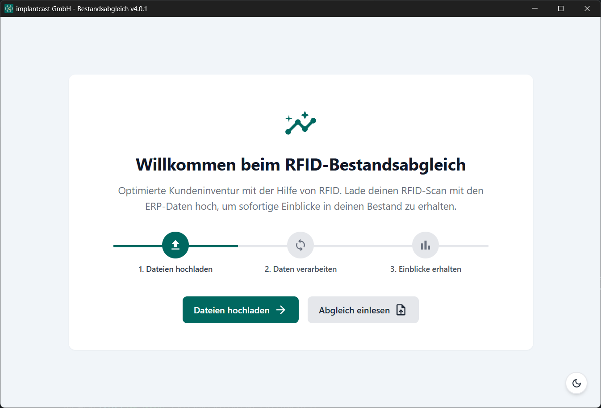
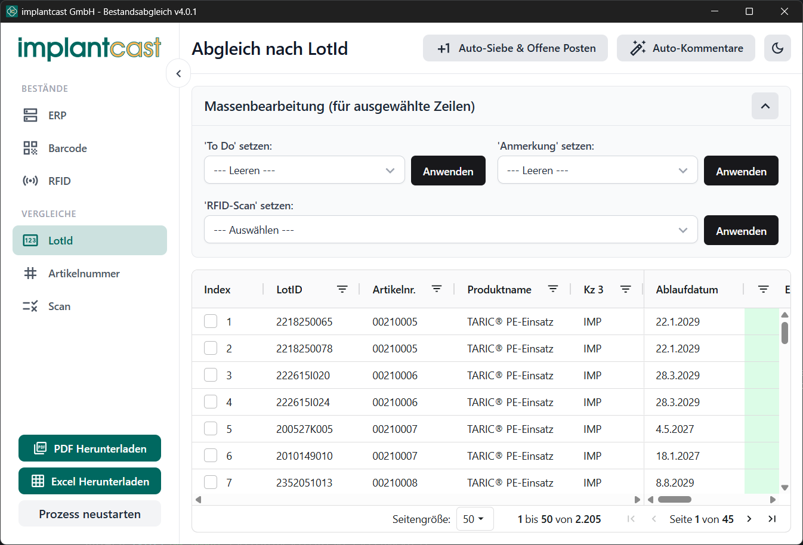

# RFID-Applikation – Bestandsabgleich v4.1.3

Um eine händische Inventur beim Kunden effizienter zu gestalten, wurde eine RFID-unterstützte Inventur eingeführt. Diese soll den händischen und zeitintensiven Prozess ablösen.
Dafür wurde eine Software für implantcast entwickelt, welche die erfassten Daten des RFID-Geräts mit unserem Bestand abgleicht.

Damit dieser Abgleich stattfinden kann, müssen vom durchführenden Mitarbeiter folgende Dateien vorbereitet / angefordert werden:

- Ein Master-Excel (gleich für alle Kunden): GTIN-Zuordnung für RFID-Scans — in der Neuauflage einmalig in die App übernommen; Ergebnis-Excel erzeugt das Programm selbst
- Ein tagesaktueller Abzug aus unserem ERP-System aller Produkte die laut unserer Daten beim Kunden liegen sollten (Excel)
- Das Programm für den Bestandsabgleich

## Dokumentation

Ausführliche Dokumentation: [documentation/README.md](./documentation/README.md)

Für einen geplanten Rewrite (UI, Implementierung, Tests, Performance) zuerst lesen:

- [Product Intent](./documentation/product-intent.md)
- [User Flows](./documentation/user-flows.md)
- [Data Model & Business Rules](./documentation/data-model-and-rules.md)
- [Feature Parity](./documentation/feature-parity.md)

## Tech Stack

Das Programm wurde mit folgenden Tools & Frameworks geschrieben:

**Frontend:** React, wouter, TailwindCSS, RadixUI, MaterialIcons, AG-Grid

**Applikation:** Tauri v2, Node

**Programmiersprachen:** TypeScript, (Rust möglich, aber nicht verwendet)

## Screenshots

|            Start Screen             |             Editor View              |
| :---------------------------------: | :----------------------------------: |
|  |  |
