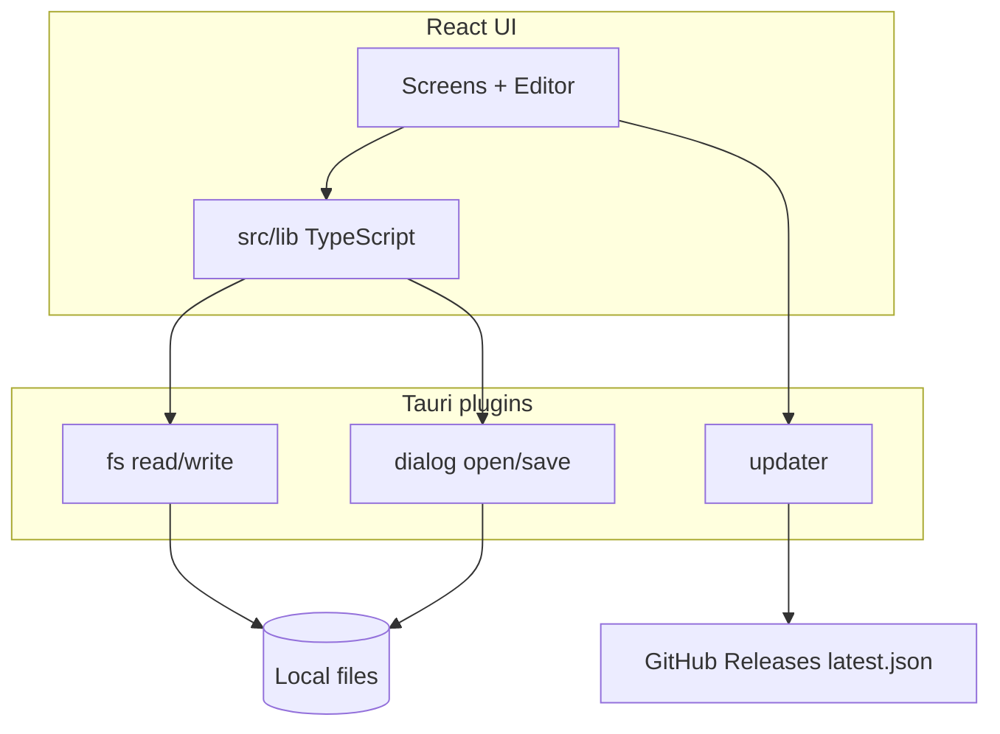

# Current Architecture (v4.1.3)

As-is technical map. For product behavior see [product-intent.md](./product-intent.md). For rewrite targets see [rework-notes.md](./rework-notes.md).

> **Snapshot of v4.1.3 (before the v5 rewrite).** The layout and module table below describe v4 and no longer match the code. The current project structure is described in the [root README](../README.md#projektstruktur).

---

## Stack

| Layer | Choice |
|-------|--------|
| Shell | Tauri v2 (Windows WebView) |
| UI | React 18 + TypeScript + Vite 5 |
| Routing | wouter |
| Styling | TailwindCSS 3 (+ class dark mode) |
| Tables | AG Grid Community (+ DE locale) |
| Icons | MUI Icons (MUI components unused) |
| Primitives | Radix (toast, collapsible, alert-dialog) |
| Spreadsheets | SheetJS `xlsx` 0.20.3 (CDN tarball) |
| PDF | Rust Typst (`typst-as-lib`) via Tauri `export_abgleich_pdf` |
| Native plugins | dialog, fs, updater (+ process used from npm but incomplete in Rust) |

---

## Repository layout

```
rfid-bestandsabgleich/
├── src/                    # React app (all domain logic)
│   ├── main.tsx            # Routes + ThemeProvider
│   ├── StartScreen.tsx
│   ├── FileUploadScreen.tsx
│   ├── ProcessingScreen.tsx
│   ├── EditorScreen.tsx
│   ├── components/
│   │   ├── editor/         # Sidebar, header, tables
│   │   └── ui/             # Dropzone, dialogs, toasts
│   ├── context/ThemeContext.tsx
│   └── lib/                # parse, compare, pdf, download
├── src-tauri/              # Thin Tauri host (almost no Rust logic)
├── documentation/
├── public/                 # Brand assets
└── .github/workflows/release.yml
```

---

## Runtime architecture



**Dependency direction today:** UI screens own orchestration; `lib` is procedural helpers (not a clean domain layer). State lives in:

1. Component `useState`
2. wouter `history.state` (session handoff)
3. Mutated SheetJS `WorkBook` object
4. `localStorage.theme`

No global store, no persistence DB, no backend.

---

## Module responsibilities

| Module | Responsibility |
|--------|----------------|
| `readFiles.ts` | Tauri FS → SheetJS workbooks; `processFiles`; `loadComparisonFile` |
| `compare.ts` | Enrich, dedupe, write comparison sheets |
| `download.ts` | Normalize ArtNr/LotId sheets for Excel out |
| `pdf.ts` | Map LotId rows → invoke `export_abgleich_pdf` + save dialog |
| `file-actions.ts` | Excel/PDF download wrappers + open-existing |
| Editor tables | AG Grid presentation; LotId mutations |
| `ThemeContext` | light/dark + persistence |

Rust `main.rs`: plugins + catalog commands + `export_abgleich_pdf`.

### Rust domain library (partially wired)

`src-tauri/src/domain/` implements parse / compare / export / catalog / editor / **pdf** (Typst). PDF export is wired to the UI; inventur parse/compare still runs via SheetJS. See [domain-rust.md](./domain-rust.md).

---

## UI composition (Editor)

```
EditorScreen
├── Sidebar (nav + PDF/Excel/Restart)
└── EditorPage
    ├── EditorHeader (title, auto-actions, Stichproben, theme)
    └── Active table (LotId | ArtNr | ERP | RFID | Barcode | Scan)
```

---

## Build & release

| Item | Detail |
|------|--------|
| Dev | `npm run tauri dev` (Vite `:1420`) |
| Build | `npm run tauri build` / CI `nsis,updater` |
| CI trigger | PRs → `cargo test`; push to `main` → `cargo test` then GitHub Release |
| Version sync | `package.json` + `Cargo.toml` + `tauri.conf.json` (+ window title string) |
| Signing | `TAURI_SIGNING_PRIVATE_KEY` + embedded pubkey |
| Tests | Rust domain: `cd src-tauri && cargo test`. CI: `.github/workflows/ci.yml` on PRs; release.yml runs `cargo test` before publish |

Documented workflow: develop on `development` / feature branches; `main` is release.

---

## Security / capability notes

- Capability platform: **Windows only**.
- FS scope: `**` (unrestricted) — should be tightened in a rewrite.
- CSP: `null`.
- Updater endpoint hardcoded to public repo releases.
- `plugin-process` used for relaunch in UI but not registered in Rust/capabilities (latent bug).

---

## Tech debt touching architecture

1. Session only in `history.state` — refresh loses work.
2. ProcessingScreen developer path fallback.
3. Implicit spreadsheet schemas — no zod/io-ts validation.
4. Mixed UI libraries (Radix + AG Grid + MUI icons + Tailwind).
5. `documentation/structure.md` partially stale (`.js` names).
6. Business rules embedded in UI handlers (auto-fill) instead of domain module.
7. Compare algorithm on UI thread; O(n×m) GTIN lookup.
