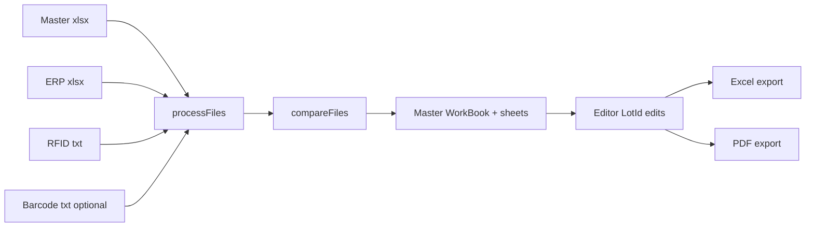

# Data Model & Business Rules

Technical contracts implied by `src/lib/*` and the editor. Required reading for any rewrite of the comparison engine or exports.

Primary sources:

- `src/lib/readFiles.ts`
- `src/lib/compare.ts`
- `src/lib/download.ts`
- `src/lib/pdf.ts` (+ Rust `domain/pdf`)
- `src/components/editor/tables/lotid_table.tsx`
- `src/EditorScreen.tsx`

---

## Pipeline overview



Result object passed to Editor / downloads:

```ts
{ masterData: WorkBook; debitor: string }
```

There are **no strong TypeScript row interfaces** today — field names are string keys on sheet JSON (`DataRow = Record<string, any>`).

---

## Input schemas

### Inventur-Master (Excel) — GTIN source only (rewrite)

**Product decisions (rewrite):**

| Rule | Detail |
|------|--------|
| Scope | **Same Master / GTIN list for all clients** |
| Import | File is **copied into the app**, not updated in place on disk |
| Runtime store | GTINs live **in-app** (SQLite/JSON/etc.) for speed — **not** re-read from xlsx every Inventur |
| Updates | **Additive**: new GTINs appear over time; **existing GTIN → product mappings never change** |
| Old projects | **No re-enrichment** when the list grows — known GTINs are stable |
| Export | Result Excel is **created by the program** — **not** by cloning/mutating a Master workbook. **Sheet names (and column contracts) match today’s export for Logistik parity** |

**Legacy v4 behavior (for migration awareness only):** today’s code uses Master as both enrichment sheet 0 **and** the mutated base of the export workbook (original sheets preserved). That template-as-export-shell approach is **retired** in the rewrite.

Import mapping (from Master sheet used for GTINs — sheet 0 today):

| Column | Use |
|--------|-----|
| `GTIN` | Lookup key for RFID enrichment |
| `Artikelnummer` | Product REF |
| `Produktname` | Display name |
| `Kennzeichen 3` | Category (`IMP` / `INST` / `SIEB` / other) |

Enrichment at compare time: `HashMap<GTIN, ProductInfo>` from the in-app store (O(1)), not SheetJS sheet scans.

### ERP-Daten (Excel)

- First sheet only (`sheets: 0`).
- Headers from file (`header: 0`).
- Consumed / important fields:

| Column | Notes |
|--------|-------|
| `Artikelnummer` | Aggregation key (ArtNr compare) |
| `Produktname` | Copied to comparisons |
| `LotId` | Trimmed; empty omitted from LotId ERP map |
| `Kennzeichen 3` | Sort + auto-SIEB/INST |
| `Ablaufdatum` | MHD. Excel date cells are read as `dd.mm.yyyy`; `-` if missing in LotId result |
| `Debitorenkonto` | Debitor = first row value or `"Unbekannt"` |
| `Physischer Bestand` | Renamed → `Eigenbestand nach ERP` |
| `Insgesamt bestellt` | **Offene Posten marker** (see below) |

Written as sheet **`Ax-Bestand`** (stock rows only).

#### MHD display

- Excel date cells are read as `dd.mm.yyyy` (a time is appended only when the cell has one).
- The UI shows dates as `dd.mm.yyyy`. It also reads ISO dates and 5-digit Excel serials (drafts from before the fix). Unreadable values show `-`.

#### Offene Posten (ordered, not on site)

- A **number** in `Insgesamt bestellt` makes the row an Offene Posten. That number is its `Offen` count, written as a whole number when it is whole (`2.0` becomes `2`). Any number counts, including `0` (see footguns).
- A blank or non-numeric cell keeps the row a stock row.
- Open positions are kept out of `Ax-Bestand`. They do not count in SOLL, IST, Abweichung, the LotId or ArtNr rows, the Stichproben quota, or the auto rules.
- Fields: `Artikelnummer`, `Produktname`, `LotId`, `Ablaufdatum` (shown as MHD), `Offen`. Sorted by Artikelnummer (numeric), then LotId.

### RFID-Scan (TXT)

- Parsed as SheetJS string workbook; **no header row** — fixed columns assigned:

```
GTIN | LotId | Kennung 1 | Debitorennummer | Erfasst um
```

- Rows containing `"["` in a cell are filtered out.
- LotId cleanup: strip first run of characters outside `[a-zA-Z0-9-]` (comment mentions `/` allowed; regex does **not** keep `/`).
- Enrichment via Master GTIN → `Artikelnummer`, `Produktname`, `Kennzeichen 3` (or `"Unbekannt"`).
- Deduped by LotId (first wins; empty LotId skipped).
- Written as **`RFID-Scan`**.

### Barcode-Scan (TXT, optional)

- Fixed columns after parse:

```
Debitorenkonto | Inventurdatum | Methode | GTIN | MHD | LotId
```

- Last cell treated as GS1-like string **only if length === 37**:

| Slice | Field |
|-------|-------|
| `substring(3, 17)` | GTIN |
| `substring(18,24)` as YYMMDD (`2000+YY`) | MHD → locale date |
| `substring(26, length-1)` | LotId |

- Written as **`Barcode-Scan`**.
- If present and non-empty → also **`Vergleich der Scans`**.

---

## Workbook sheet contract

**Rewrite export target:** app **generates** a new workbook using **these same sheet names** (Logistik parity). No original Master sheets are copied into the export.

| Sheet name | Produced by | Role |
|------------|-------------|------|
| `Ax-Bestand` | compare / export | ERP stock rows (`Insgesamt bestellt` empty) |
| `Offene Posten` | compare / export | Open positions outside the Abgleich (see ERP section). Always written with headers `Artikelnummer`, `Produktname`, `LotId`, `Ablaufdatum`, `Offen`, `id`. Optional on reload: a missing or empty sheet loads as no open positions |
| `RFID-Scan` | compare / export | Enriched RFID |
| `Barcode-Scan` | compare / export (optional) | Barcode rows |
| `Vergleich der Scans` | compare / export (if barcode) | LotId barcode vs RFID flags |
| `Bestandsabgleich Artikelnummer` | compare + editor sync | ArtNr aggregates |
| `Bestandsabgleich LotId` | compare + editor sync | Lot-level reconciliation |

**Legacy v4 only:** original Master sheets were preserved inside the mutated workbook. That is dropped in the rewrite.

**Reload requirement** (`loadComparisonFile` / import): workbook **must** contain:

- `Bestandsabgleich Artikelnummer`
- `Bestandsabgleich LotId`

---

## Comparison algorithms

### Matching keys

| Stage | Key |
|-------|-----|
| RFID enrichment | `GTIN` |
| RFID dedupe | `LotId` |
| Barcode ↔ RFID | `LotId` |
| ERP ↔ RFID (ArtNr) | `Artikelnummer` |
| ERP ↔ RFID (Lot) | `LotId` |

GTIN is **not** used to match ERP to scans.

### ArtNr result row

```ts
{
  Artikelnummer: string
  Produktname: string
  "Eigenbestand nach ERP": number  // count of ERP rows with ArtNr
  "RFID-Scan": number              // count of RFID rows with ArtNr
  Differenz: number                // ERP - RFID
  id: string                       // uuid at compare; editor may set id = Artikelnummer
}
```

**Semantics:** counts **rows**, not the ERP quantity column. Presence of `Physischer Bestand` does not feed ArtNr math after rename on ERP sheet.

Color in UI:

| Differenz | Meaning |
|-----------|---------|
| `0` | Match (green) |
| `< 0` | RFID surplus (amber) |
| `> 0` | ERP surplus / missing scans (red) |

### LotId result row

```ts
{
  Artikelnummer: string
  Produktname: string
  "Kennzeichen 3": string
  LotId: string
  "Eigenbestand nach ERP": "1" | "0"  // strings
  "RFID-Scan": "1" | "0"              // strings; editable as number in grid
  Ablaufdatum: string | "-"
  "To Do": string
  Anmerkung: string
  Stichprobe: string                  // "" | "X"
  id: string                          // uuid
  Index: number                       // 1..n
}
```

Union of all LotIds from ERP map and RFID map. Presence is binary even if ERP had quantities.

Sort: Kennzeichen 3 groups `IMP` → `INST` → `SIEB` → other, then Artikelnummer.

UI colors ERP vs RFID:

| ERP | RFID | Meaning |
|-----|------|---------|
| 1 | 1 | Match (green) |
| 1 | 0 | Expected missing (red) |
| 0 | 1 | Extra scan (amber) |

Empty **To Do** when ERP ≠ RFID → violet highlight (needs attention).

### Scan comparison row

```ts
{ LotId: string; "Barcode-Scan": 0 | 1; "RFID-Scan": 0 | 1 }
```

---

## Editor mutation rules

### Source of truth while editing

1. `lotIdData` (React state) is primary.
2. `artNrData` recomputed: group by Artikelnummer, sum ERP & RFID fields, `Differenz = ERP - RFID`.
3. Both arrays written back into `masterData.Sheets[...]` via `json_to_sheet` before export.
4. `offene_posten` is read-only: it travels with the snapshot unchanged and is never edited or counted in the editor stats.

### Editable LotId fields

| Field | Editor | Values |
|-------|--------|--------|
| `RFID-Scan` | numeric cell | `0` / `1` |
| `To Do` | select | see vocabulary |
| `Anmerkung` | select | see vocabulary |
| `Stichprobe` | select | `""` \| `"X"` |

Bulk apply supported for To Do, Anmerkung, RFID-Scan on multi-selected rows.

### Auto-Kommentare (`handleAutoFillKommentare`)

Within the same `Artikelnummer`, pair unmatched lots when both To Dos empty:

| Condition | Assigned To Do |
|-----------|----------------|
| ERP=1, RFID=0 (missing) | `interne Berechnung` |
| ERP=0, RFID=1 (extra) | `interne Gutschrift mit Rückbuchung auf Konsi` |

Pair count = `min(missingCount, scannedCount)`.

### Auto SIEB/INST & Offene Posten

| Condition | Effect |
|-----------|--------|
| `Kennzeichen 3 === "SIEB"` | Force `RFID-Scan = 1` |
| `Kennzeichen 3 === "INST"` and RFID=0 | Force `RFID-Scan = 1` |
| ERP=0 and RFID=0 | Set Anmerkung `offener Posten` |

### Stichproben

- Progress: count of LotId rows with `Stichprobe` trimmed uppercase === `"X"`.
- **Required quota:** `ceil(1% × Σ Ax-Bestand ERP quantity)` where quantity is `ErpRow.eigenbestand_nach_erp` (invalid/empty → 0). Integer form: `(total + 99) / 100`. Total 0 → required 0.
- Badge: `done / required` — red at 0 (when required > 0), amber while incomplete, emerald when `done >= required`.
- **Hard gate:** Excel export, PDF export, and **Fertig** (status `done`) are blocked until the quota is met.

---

## Controlled vocabularies (must preserve for process parity)

### To Do

```
""
berechnen + liefern
interne Berechnung
interne Gutschrift mit Rückbuchung auf Konsi
NUR berechnen
NUR liefern auf Konsi
Resteriaustausch
über Gutschrift ins Konsi buchen
Storno / offener Posten
```

### Anmerkung

```
""
AWS
bereits unterwegs
Ersatzartikel
geht zurück
in Klärung
Kaufware
kein RFID Chip
Klinik bestellt
Mitnahme
nicht scanbar / Lot korrekt
offener Posten
```

---

## Export rules

### Excel (`downloadFile` + `handleExcelDownload`)

- Rebuild ArtNr + LotId sheets with a **fixed column order**.
- Keep `id` on those sheets.
- `Offene Posten` sheet: fixed header order `Artikelnummer, Produktname, LotId, Ablaufdatum, Offen, id`; written even when empty.
- Drop ephemeral UI fields such as `isEdited` (written in editor but unused / stripped).
- Other sheets left as-is.
- Save via Tauri dialog + `writeFile`.

### PDF (`export_abgleich_pdf` / `src/lib/pdf.ts`)

- Rendered in Rust via embedded Typst (`assets/pdf/abgleich.typ` → `typst-pdf`).
- Landscape **LotId table** (no signature page in the inventur export), followed by an optional **Offene Posten** table.
- Header: `Bestandsabgleich · ${debitor}` (+ Kundenname subtitle when known), date/time, blank Außendienstmitarbeiter.
- Totals: Anzahl Positionen; SOLL (sum ERP presence flags); IST (sum RFID); Abweichung = IST − SOLL.
- Columns: Index, Kennz., REF, Produkt, LotId, Verfall, Bestand ERP/RFID, To Do, Anmerkung, Stichprobe.
- **Offene Posten table** (only when open positions exist): heading, the note "Bestellt, aber nicht im Bestand vorhanden. Nicht in SOLL, IST oder Abweichung enthalten.", then a 75%-width table with columns Artikelnummer, Produkt, LotId, MHD, Offen. Never part of the totals. Input key `offene_posten` with fields `artikel, produkt, lot_id, verfall, offen`.
- Footers: German `Seite i von n` + client line + inventur date; repeating table headers via Typst `table.header`.
- Brand header green `#006860`; Unicode via embedded DejaVu Sans; logo from `src-tauri/assets/images/ic-logo.png`.

### Blank Bestätigungsformular (`export_bestaetigung_pdf`)

- Separate home download (settings → Formulare) for printing form stacks.
- Landscape blank fields: Kundennummer, Ort, Datum, Unterschrift Außendienst + Kunde; implantcast address.
- Template: `assets/pdf/bestaetigung.typ` (no customer autofill).

---

## Performance characteristics (current)

| Issue | Detail |
|-------|--------|
| UI-thread parse/compare | No Web Workers |
| GTIN enrichment | `O(n×m)` `find` per RFID row |
| Dense cell walks | Extra pre-pass on sheets |
| Editor sync | Full ArtNr recompute on every LotId change |
| Excel export | `structuredClone` of entire workbook |
| PDF | Rust Typst via Tauri (jsPDF / printpdf HTML removed) |

Rewrite should treat pure compare/parse as unit-testable, off-main-thread candidates.

---

## Known logic footguns

1. LotId regex cleanup lacks global flag and does not preserve `/`.
2. ArtNr counts rows, not ERP quantities — can surprise if ERP has multi-qty lines.
3. ProcessingScreen hardcoded fallback paths.
4. Barcode parse only for length-37 trailing cells.
5. `isEdited` flag never consumed.
6. Nested toast providers in Editor + LotIdTable.
7. `Insgesamt bestellt` counts any number, including `0`. A zero-filled column moves every ERP row out of the Abgleich.
8. Drafts and Abgleich files created before the MHD fix can hold raw Excel serials (e.g. `46143`) in `Ablaufdatum`. The tables show them as dates, but the PDF prints the stored text.
