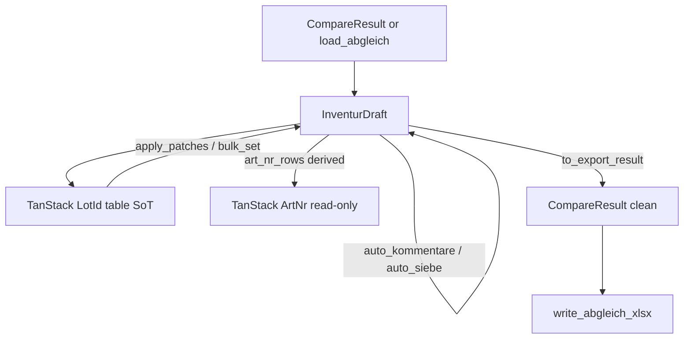
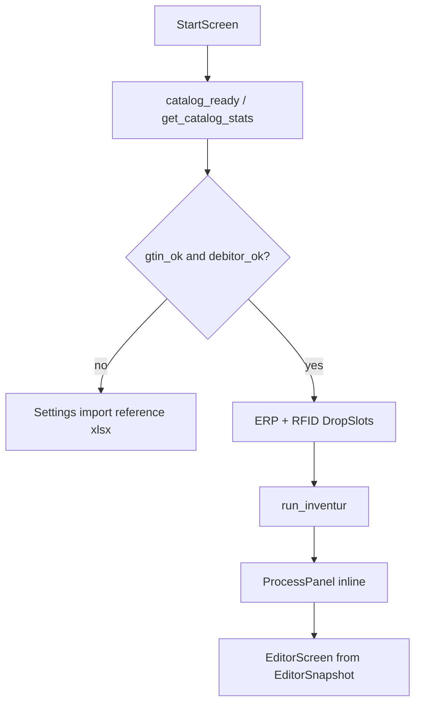

# Rust Domain Engine (Import & Comparison)

Status: **implemented and home/editor wired** for inventur start + Abgleich reload via `EditorSnapshot`. Auto-Kommentare / Auto-SIEB still run in TypeScript this slice; TanStack rewrite is follow-up. This document describes the pure Rust domain under `src-tauri/src/domain/`.

Related: [import-stack-research.md](./import-stack-research.md), [data-model-and-rules.md](./data-model-and-rules.md), [rework-notes.md](./rework-notes.md).

---

## Why

Move parse / normalize / compare / Excel export off the WebView main thread and into testable Rust modules using:

| Concern | Crate |
|---------|-------|
| Excel read | `calamine` ≥ 0.32 |
| RFID TXT | `csv` (BurntSushi) |
| Excel write | `rust_xlsxwriter` |
| PDF | Typst (`typst-as-lib` + `typst-pdf`, landscape A4) |
| Errors | `thiserror` |

Session model for a future UI wire-up: typed JSON DTOs (`CompareResult` / `EditorSnapshot`), **not** a SheetJS `WorkBook`.

**Barcode scan input is out of scope** for this engine (no parse, no `Vergleich der Scans`, no barcode export sheets).

---

## Module map

```
src-tauri/src/
├── lib.rs                 # public API re-exports
├── commands.rs            # catalog + inventur + export_abgleich_pdf
├── main.rs                # Tauri host
└── domain/
    ├── types.rs           # row DTOs + sheet name constants
    ├── error.rs           # DomainError (German operator messages)
    ├── normalize.rs       # GTIN / LotId key rules
    ├── gtin.rs            # HashMap catalog, additive insert
    ├── catalog/           # on-device SQLite catalog (GTIN + Debitoren)
    ├── inventur.rs        # catalog_ready + run_inventur + load_abgleich
    ├── parse/
    │   ├── excel.rs       # calamine helpers
    │   ├── master.rs      # GTIN catalog from sheet 0
    │   ├── erp.rs         # first sheet → ErpRow + debitor
    │   ├── rfid.rs        # TXT → enriched + deduped RfidRow
    │   └── abgleich.rs    # load exported Abgleich → CompareResult
    ├── compare/
    │   ├── art_nr.rs      # inventur-time row-count aggregation
    │   ├── lot_id.rs      # binary presence + IMP/INST/SIEB sort
    │   └── mod.rs         # run_compare orchestration
    ├── editor/
    │   ├── vocabulary.rs  # To Do / Anmerkung constants
    │   ├── aggregate.rs   # LotId → ArtNr (editor recompute)
    │   ├── auto_kommentare.rs
    │   ├── auto_siebe.rs
    │   └── draft.rs       # InventurDraft session (edit → export)
    ├── export/
    │   └── xlsx.rs        # scratch workbook (never clones Master)
    └── pdf/
        └── render.rs      # Typst → Vec<u8> (`abgleich.typ` + blank `bestaetigung.typ`)
```

---

## Public API

```rust
load_gtin_catalog(path) -> GtinCatalog
parse_erp(path) -> (Vec<ErpRow>, debitor)
parse_rfid(path, &catalog) -> Vec<RfidRow>
run_compare(CompareInput) -> CompareResult
write_abgleich_xlsx(&CompareResult, path) -> ()
load_abgleich_xlsx(path) -> CompareResult

// Editor rules
aggregate_art_nr_from_lot_id(&[LotIdCompareRow]) -> Vec<ArtNrCompareRow>
auto_fill_kommentare(&[LotIdCompareRow]) -> AutoKommentareResult
auto_siebe_and_offene_posten(&[LotIdCompareRow]) -> AutoSiebeResult

// Draft session (preferred path after compare / reload)
InventurDraft::from_compare(CompareResult)
draft.apply_patches(&[LotIdPatch])
draft.bulk_set(ids, LotIdEditField, value)
draft.run_auto_kommentare() / draft.run_auto_siebe()

// PDF (wired to UI)
render_abgleich_pdf(&PdfExportInput) -> Vec<u8>
render_bestaetigung_pdf() -> Vec<u8>  // blank form for home download
draft.snapshot() -> EditorSnapshot
draft.to_export_result() -> CompareResult   // ArtNr freshly aggregated
draft.write_xlsx(path)

// Home inventur orchestration (`domain/inventur` + Tauri commands)
catalog_ready_from_stats(CatalogStats) -> CatalogReady
require_catalog_ready(&CatalogDb) -> CatalogReady
run_inventur(&CatalogDb, erp_path, rfid_path) -> EditorSnapshot
load_abgleich(&CatalogDb, path) -> EditorSnapshot  // resolves kundenname via Debitor store
```

JSON field names are **snake_case** (one contract for Tauri ↔ frontend).

Run tests:

```bash
cd src-tauri
cargo test
```

---

## Edit → Aggregate → Export (`InventurDraft`)



### Hard rules

1. **LotId rows are the only editable inventur data.** ArtNr is never patched by the UI.
2. **ArtNr for editor + export-after-edits** = `aggregate_art_nr_from_lot_id` (sum of presence flags). Inventur-time `compare_art_nr` (raw row counts) is ignored once a draft is created.
3. **Row identity** = `LotIdCompareRow.id` (stable UUID).
4. **Ephemeral UI state** (`edited_ids`, selection) lives on the draft / React — never in Excel.
5. **Raw sheets** `ax_bestand` / `rfid_scan` pass through unchanged.

### Editable LotId fields

| Field | Values |
|-------|--------|
| `rfid_scan` | `"0"` \| `"1"` (numeric `0`/`1` coerced) |
| `to_do` | `TODO_OPTIONS` (incl. `""`) |
| `anmerkung` | `ANMERKUNG_OPTIONS` (incl. `""`) |
| `stichprobe` | `""` \| `"X"` (`x` normalized to `X`) |

`eigenbestand_nach_erp` is **read-only** (not on `LotIdPatch`). Invalid values → `DomainError::InvalidEdit`.

### Supported post-edit export

```rust
draft.apply_patches(...)?;
// or bulk_set / run_auto_*
write_abgleich_xlsx(&draft.to_export_result(), path)?;
// or: draft.write_xlsx(path)?;
```

---

## TanStack Table contract (UI not wired yet)

Use `EditorSnapshot` from `draft.snapshot()` as the single UI payload.

### LotId table (source of truth)

- `data = snapshot.lot_id_rows`
- `getRowId = (row) => row.id`
- **Editable accessors:** `rfid_scan`, `to_do`, `anmerkung`, `stichprobe`
- **Read-only:** `index`, `lot_id`, `artikelnummer`, `produktname`, `kennzeichen_3`, `ablaufdatum`, `eigenbestand_nach_erp`
- On cell commit → one `LotIdPatch { id, … }` → `draft.apply_patches`
- On bulk toolbar → `draft.bulk_set(selectedIds, LotIdEditField::…, value)`
- After each mutation → replace local state from `draft.snapshot()`
- Dirty highlight: `snapshot.edited_ids.includes(row.id)` — do **not** write `isEdited` into export rows
- Select options: `domain::editor::vocabulary::{TODO_OPTIONS, ANMERKUNG_OPTIONS}`

### ArtNr table (derived, read-only)

- `data = snapshot.art_nr_rows`
- No cell editors; refresh comes for free from the next snapshot after LotId edits

### Stats / chrome

- `snapshot.stats.abweichungen` / `offene_todos` / `stichproben_done` / `stichproben_required` / `erp_quantity_total`
- `stichproben_required = ceil(1% of erp_quantity_total)` from Ax-Bestand quantities
- `snapshot.dirty` for save affordances

---

## Editor rules (`domain/editor`)

Parity with `EditorScreen.tsx`. Prefer calling them via `InventurDraft` so dirty/`edited_ids` stay consistent.

| Function | Behaviour |
|----------|-----------|
| `aggregate_art_nr_from_lot_id` | Sum LotId presence flags per Artikelnummer; `id = artikelnummer`. **Not** inventur-time `compare_art_nr`. |
| `auto_fill_kommentare` | Per ArtNr, pair missing (ERP1/RFID0) with extra (ERP0/RFID1) when both To Dos empty |
| `auto_siebe_and_offene_posten` | SIEB → RFID=1; INST+RFID0 → RFID=1; ERP0+RFID0 → Anmerkung `offener Posten` |

---

## Export sheets

| Sheet | Always |
|-------|--------|
| `Ax-Bestand` | yes |
| `RFID-Scan` | yes |
| `Bestandsabgleich Artikelnummer` | yes |
| `Bestandsabgleich LotId` | yes |

---

## Reload Abgleich (`load_abgleich_xlsx`)

Reads a previously written (or legacy v4) comparison workbook into `CompareResult`. Does **not** re-run compare — sheet values are trusted. Wrap with `InventurDraft::from_compare` for editing.

| Rule | Detail |
|------|--------|
| Required sheets | `Bestandsabgleich Artikelnummer` + `Bestandsabgleich LotId` |
| Optional sheets | `Ax-Bestand`, `RFID-Scan` (empty vectors if missing) |
| Ignored | Barcode sheets, leftover Master sheets |
| Debitor | First `Debitorenkonto` on `Ax-Bestand`, else `"Unbekannt"` |
| Columns | Bound by **header name** |
| Missing ids | New UUID generated |
| Errors | `DomainError::InvalidAbgleich` |

---

## Intentional behaviour vs v4

| Topic | v4 footgun | Domain behaviour |
|-------|------------|------------------|
| GTIN match | `number` vs `string` miss | Always normalize to trimmed string |
| LotId trim | ERP trimmed, RFID not | Trim **both** |
| LotId cleanup | Regex without `g`; `/` removed despite comment | Global replace; keep `[A-Za-z0-9/-]` |
| RFID `[` rows | Cell deleted → column shift | **Drop whole row** |
| Kennzeichen | Only `Kennzeichen 3` | Prefer `Kennzeichen 3`, else `Kennzeichen` |
| ArtNr math (inventur) | Row counts | Same (Must parity) |
| ArtNr math (editor/export) | Sum of LotId flags | `InventurDraft` always re-aggregates |
| Export | Mutate / clone Master; SheetNames trap | Scratch workbook; all sheets registered |
| GTIN lookup | O(n×m) `find` | O(1) `HashMap` |
| Barcode | Optional TXT + scan compare | **Removed** from this engine |
| Reload | SheetJS workbook + name check only | Typed `CompareResult` + column validation |
| `isEdited` | Written into row objects | Draft `edited_ids` only — stripped from export |

---

## Home inventur + catalog gates

Start page (`StartScreen` / `UploadPanel`) drives inventur without `/upload` or `/processing`:



| Condition | UI |
|-----------|-----|
| `gtin_count === 0` or `debitor_count === 0` | Blocking banner; **Abgleich starten** disabled |
| Both ready + ERP/RFID paths set | Start enabled |
| Processing / success / error | `ProcessPanel` replaces Neue-Inventur card |
| **Abgleich einlesen** | `load_abgleich` → editor with `{ snapshot }` |

Frontend: `src/lib/inventur.ts`, `src/lib/catalog.ts` (`getCatalogReady`, `catalogGateMessage`).

`/upload` and `/processing` redirect to `/`. Barcode / Scan nav items removed from the editor.

## Wiring status

- **PDF:** wired (`export_abgleich_pdf` / `export_bestaetigung_pdf` → `domain/pdf` + `src/lib/pdf.ts`)
- **Catalog:** wired (Settings import + typeahead + home readiness gates)
- **Inventur home:** wired (`run_inventur`, `load_abgleich`, `catalog_ready` → `EditorSnapshot`)
- **Still in TypeScript this slice:** Auto-Kommentare / Auto-SIEB / ArtNr recompute in `EditorScreen`; Excel download builds a SheetJS workbook from grid rows
- **Not yet:** TanStack Table React components; inventuren project persistence (grid stays mock)

Next step when ready: invoke editor autos via Rust draft commands + retire remaining SheetJS export adapters.
