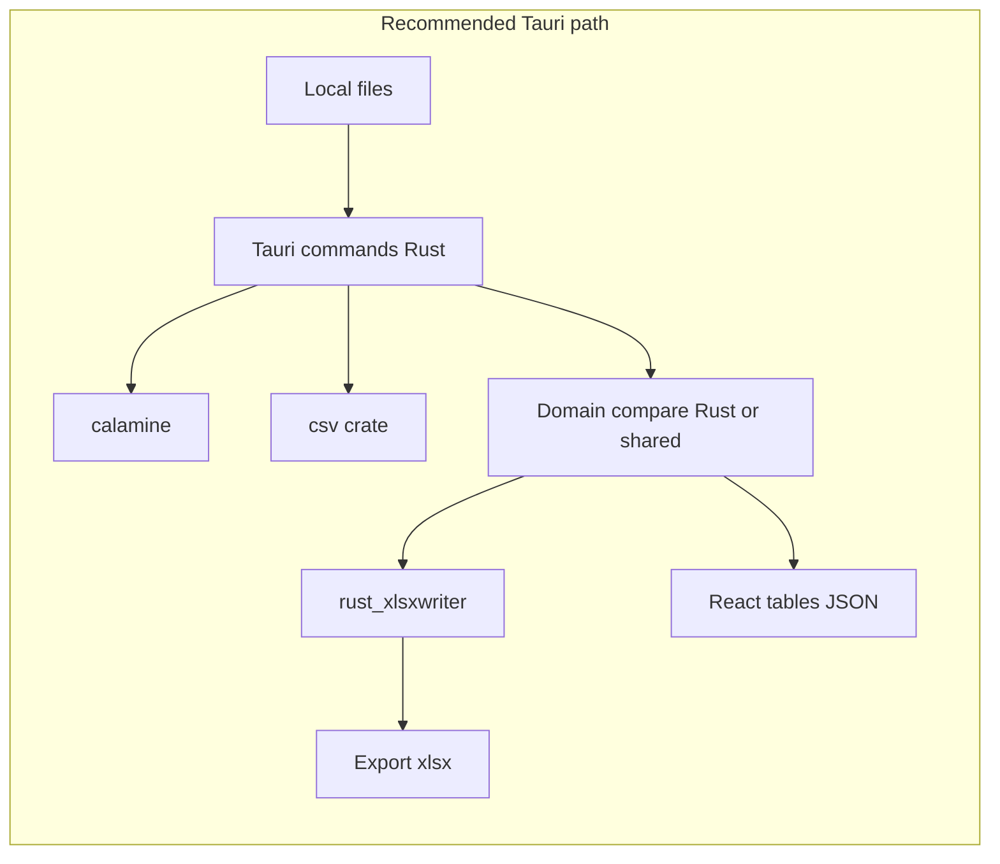

# Import / Export Stack Research (Excel + CSV/TXT)

Research date: **2026-03-11**. Goal: choose production libraries for the rewrite — performance, features, and **security** — not hobby/DIY parsers.

Applies to this app’s real IO:

| Input | Format today | Role |
|-------|--------------|------|
| Inventur-Master | `.xlsx` / `.xls` | Read GTIN catalog (+ preserve other sheets on export) |
| ERP | `.xlsx` / `.xls` | Read first sheet |
| RFID scan | `.txt` (delimited, no header) | Parse rows → GTIN, LotId, … |
| Barcode scan | `.txt` | Parse rows + GS1-ish 37-char field |
| Abgleich export | `.xlsx` | Write multi-sheet workbook |
| Abgleich reload | `.xlsx` | Read named comparison sheets |

**Important:** RFID/Barcode are **not** Excel. Today they are forced through SheetJS (`read(..., { type: "string" })`). That is a major smell for both performance and correctness.

---

## Executive recommendation

| Layer | Recommendation | Why |
|-------|----------------|-----|
| **Excel read (Tauri rewrite)** | Rust **`calamine` ≥ 0.32.0** | Mature, MIT, ~17M downloads, lazy XLSX, actively maintained; pin past OOM fix |
| **Excel write (export)** | Rust **`rust_xlsxwriter`** | Production writer by XlsxWriter author; constant-memory mode; do **not** mutate Master in place |
| **TXT / CSV** | Rust **`csv`** (BurntSushi) | De-facto standard; no advisories; serde; streaming |
| **If staying in JS** | Keep **SheetJS CE 0.20.3** (CDN/vendored) for Excel + **Papa Parse ≥ 5.2** (or `csv-parse`) for TXT | Already mostly correct for Excel; stop using SheetJS for scans |
| **Avoid for new code** | `exceljs` (unmaintained + CVEs), experimental napi wrappers (`sheetkit`), frozen forks (`xlsx-js-style`), npm registry `xlsx@0.18.5` | Security / maintenance risk |

**Is Rust better here?** For *this* Tauri app: **yes for parse + compare + Excel write**, because you already ship a Rust host, files are local, and work is CPU/memory bound. Keep domain results as typed JSON/rows for the React UI; do not keep SheetJS `WorkBook` as the session model.

---

## Current stack (baseline)

- Package: SheetJS CE via `https://cdn.sheetjs.com/xlsx-0.20.3/xlsx-0.20.3.tgz` (correct install path; **not** vulnerable npm `xlsx@0.18.5`).
- Runs on the **UI thread** after Tauri FS read.
- RFID/Barcode parsed as fake workbooks.
- Export: mutate Master workbook → `xlsx.write` → disk.

Strengths: one library, broad format support (incl. legacy `.xls`), already works.  
Weaknesses: memory (in-memory dense mode), wrong tool for TXT, hard to unit-test, no native parallelism, Session = SheetJS object graph.

---

## JavaScript / TypeScript options

### SheetJS Community Edition (`xlsx`) — **keep if staying JS**

| | |
|--|--|
| Source of truth | https://cdn.sheetjs.com / docs.sheetjs.com |
| License | Apache-2.0 (CE) |
| Read | Excellent breadth (xlsx, xls, ods, csv, …) |
| Write | Good for data sheets; styling mostly Pro |
| Perf | In-memory; large files inflate RSS heavily vs streaming engines |
| Security | Use **≥ 0.19.3 / 0.20.x from CDN**. npm `xlsx@0.18.5` has known issues (prototype pollution / ReDoS era). Vendor the tarball; do not trust random “xlsx republish” packages without audit |

**Verdict:** Acceptable production choice for Excel **if vendored**. Not ideal for RFID TXT. Not the best long-term host for compare logic in a Tauri app.

### ExcelJS — **do not adopt**

| | |
|--|--|
| npm | `exceljs@4.4.0` — maintenance inactive |
| Features | Rich styling, streaming API façade |
| Security (2026) | Unpatched upstream issues reported: prototype pollution (`CVE-2026-78207`), arbitrary file read via `addImage` (`CVE-2026-78208`), CSV formula injection, decompression bombs |

**`exceljs-hardened`** (mateocallec) patches several of those as an **unofficial volunteer fork**. Useful if you are stuck on ExcelJS APIs; **not** a first-choice foundation (explicitly not a full product continuation). Treat as stopgap, not strategy.

### Papa Parse — **recommended for browser/JS TXT/CSV**

| | |
|--|--|
| Package | `papaparse` ≥ **5.2.0** (current ~5.7.x) |
| License | MIT |
| Features | Delimiter detection, workers, streaming, header mapping |
| Security | ReDoS CVE-2020-36649 fixed in 5.2.0; current releases report clean on Snyk |

Fits RFID/Barcode far better than SheetJS string workbooks. Pair with Web Worker if staying in JS.

### `csv-parse` / `csv-stringify` (Node `csv` suite)

Solid for Node; less natural inside Tauri WebView than Papa Parse unless you run a Node sidecar (you should not).

### Other JS names (status)

| Package | Status | Use? |
|---------|--------|------|
| `xlsx-populate` | MIT; encryption support; quieter maintenance | Only if you need passworded xlsx in JS |
| `xlsx-js-style` | Frozen SheetJS fork (~2022) | No |
| `@office-kit/xlsx` / `sheetstream` / `simple-excel` | Newer / niche; check maturity yourself | Not default for regulated field tool |
| **SheetKit `@sheetkit/node`** | Rust core + napi; **README: experimental** | Skip for prod until stable |

---

## Rust options (natural fit for Tauri)

Tauri already compiles Rust. Prefer **`#[tauri::command]`** that return typed rows / export paths, instead of pulling Excel bytes into the WebView.

### Read Excel — `calamine` ✅ production

| | |
|--|--|
| Crate | [`calamine`](https://crates.io/crates/calamine) (latest ~0.38.x as of research) |
| License | MIT |
| Scale | ~17M+ downloads, 300+ reverse deps |
| Formats | xlsx, xlsm, xlsb, xls, ods, … |
| Features | Lazy sheet load, streaming cell reader, serde deserializer, optional chrono |
| Limits | **Read-only**; values-focused (not full style/edit) |
| Security | **Require ≥ 0.32.0** — older versions had XLS unbounded allocation / OOM (AIKIDO-2025-10845 / GH discussion). Keep deps (`zip`, `quick-xml`) updated |

Calamine’s own benchmarks claim large wins vs excelize / ClosedXML / openpyxl for read throughput — treat as directional, but the ecosystem trust signal is strong.

### Write Excel — `rust_xlsxwriter` ✅ production

| | |
|--|--|
| Crate | [`rust_xlsxwriter`](https://crates.io/crates/rust_xlsxwriter) (~0.102.x) |
| Author | John McNamara (same lineage as Python **XlsxWriter** / libxlsxwriter) |
| License | MIT OR Apache-2.0 |
| Features | High-fidelity xlsx write, charts, tables, serde, **`constant_memory`** for large sheets |
| Limits | **Cannot modify an existing file** |

**Implication for this product (confirmed):**

1. `calamine` **once** (or rarely) imports Master → **in-app GTIN store** (additive upsert; existing keys immutable).
2. Per Inventur: `calamine` reads ERP; `csv` reads scans; enrich via in-app GTIN map.
3. `rust_xlsxwriter` **always builds the export workbook from scratch** from project data + fixed sheet schema — never clone Master.

That matches the UX decision: Master is a GTIN source for all clients, not an export shell.

### Read+write same workbook — `umya-spreadsheet`

| | |
|--|--|
| Crate | [`umya-spreadsheet`](https://crates.io/crates/umya-spreadsheet) (~3.1 stable / 4.x beta) |
| Use when | You must preserve complex Master formatting/charts while editing |
| Tradeoff | Heavier; less “gold standard” than calamine + rust_xlsxwriter split |

For implantcast exports (data sheets + comparison), **rebuild with rust_xlsxwriter** is usually enough.

### CSV / delimited TXT — `csv` ✅ production

| | |
|--|--|
| Crate | [`csv`](https://crates.io/crates/csv) by BurntSushi (~1.4.x) |
| License | Unlicense OR MIT |
| Scale | 280M+ downloads |
| Security | crates.io reports **no advisories** for current line |
| Features | Streaming, flexible delimiter, serde structs |

Configure delimiter to match real RFID exports (`\t`, `;`, or `,`). Do **not** invent a DIY splitter.

Barcode’s 37-char GS1 field stays a **small domain parser** on top of `csv` records (still not SheetJS).

### Optional: Polars

Powerful for analytics joins, but **overkill** for LotId/ArtNr reconciliation. Prefer typed Vec + HashMap unless datasets become huge.

---

## Architecture options for this rewrite

### Option A — Rust IO + domain (recommended)

- Parse/compare/export in Rust commands.
- UI receives `{ debitor, lotIdRows, artNrRows, erpRows, … }`.
- PDF can stay JS (jspdf) or move later.
- **Best perf, best security boundary, best tests.**

### Option B — Rust parse only, TS domain

- Rust returns normalized row arrays.
- Keep compare in TypeScript with Vitest fixtures.
- Still drop SheetJS for hot path.

### Option C — Stay JS

- SheetJS CE vendored for Excel only.
- Papa Parse (+ Worker) for TXT.
- Move compare off UI thread (`Worker`).
- Accept higher memory and weaker native perf.

---

## Security checklist (prod)

1. **Never** depend on npm `xlsx@0.18.5`.
2. Prefer parsers with **bounded memory** / streaming (`calamine` cell reader, `csv` streaming, `rust_xlsxwriter` `constant_memory`).
3. Treat spreadsheets as untrusted enough for **zip bombs / OOM** (ERP/Master can be large or mishandled).
4. On Excel/CSV export opened by humans: neutralize formula injection (`=`, `+`, `-`, `@`) in string cells when values can be influenced by scans.
5. Avoid abandoned JS Excel stacks (`exceljs` upstream).
6. Skip experimental napi Excel bridges until they drop the experimental banner and show sustained release/security process.
7. Pin crate/npm versions; run `cargo audit` / `npm audit` in CI.

---

## Performance expectations (honest)

Bottlenecks in **this** app today are not only the Excel library:

1. UI-thread parse + compare.
2. O(n×m) GTIN enrichment (`find` per RFID row).
3. Repeated `sheet_to_json` / `json_to_sheet`.
4. Full workbook `structuredClone` on export.
5. Using SheetJS for TXT.

Moving to Rust + `HashMap<GTIN, …>` alone can outweigh swapping SheetJS→ExcelJS. Library choice matters most for **large ERP xlsx** and **export size**.

---

## Decision matrix (this product)

| Criterion | SheetJS CE (JS) | Papa Parse (JS) | ExcelJS | calamine | rust_xlsxwriter | csv (Rust) | umya | SheetKit |
|-----------|-----------------|-----------------|---------|----------|-----------------|------------|------|----------|
| Prod maturity | High (CE) | High | Low (dead) | High | High | Very high | Medium-high | Low (experimental) |
| Security posture | OK if CDN≥0.20.3 | OK if ≥5.2 | Bad upstream | OK if ≥0.32 | Strong | Strong | OK | Unknown |
| Excel read | Excellent | N/A | OK | Excellent | No | N/A | Good | TBD |
| Excel write | Good | N/A | Rich | No | Excellent | N/A | Good | TBD |
| TXT/CSV | Misuse | Excellent | CSV only | No | No | Excellent | CSV write | No |
| Tauri fit | OK | OK | Poor choice | **Native** | **Native** | **Native** | Native | Awkward |
| Fits rewrite | Interim | Yes (scans) | No | **Yes** | **Yes** | **Yes** | If style edit needed | No |

---

## Concrete recommendation for v5

1. **Default:** Tauri commands using **`calamine` + `csv` + `rust_xlsxwriter`**.
2. Rebuild export workbooks; stop SheetJS mutation model.
3. Keep React for grids/PDF UX; feed plain row DTOs.
4. If rewrite is phased: first swap RFID/Barcode to Papa Parse / `csv`, index GTINs, add workers/tests — then move Excel to Rust.
5. Do **not** migrate to ExcelJS; do **not** bet the product on experimental SheetKit/sheetstream.

---

## Links

- calamine: https://crates.io/crates/calamine — https://github.com/tafia/calamine  
- rust_xlsxwriter: https://crates.io/crates/rust_xlsxwriter — https://rustxlsxwriter.github.io  
- csv: https://crates.io/crates/csv — https://github.com/BurntSushi/rust-csv  
- umya-spreadsheet: https://crates.io/crates/umya-spreadsheet  
- SheetJS install: https://docs.sheetjs.com/docs/getting-started/installation/nodejs/  
- Papa Parse: https://www.npmjs.com/package/papaparse  
- ExcelJS hardened (stopgap only): https://www.npmjs.com/package/exceljs-hardened  
