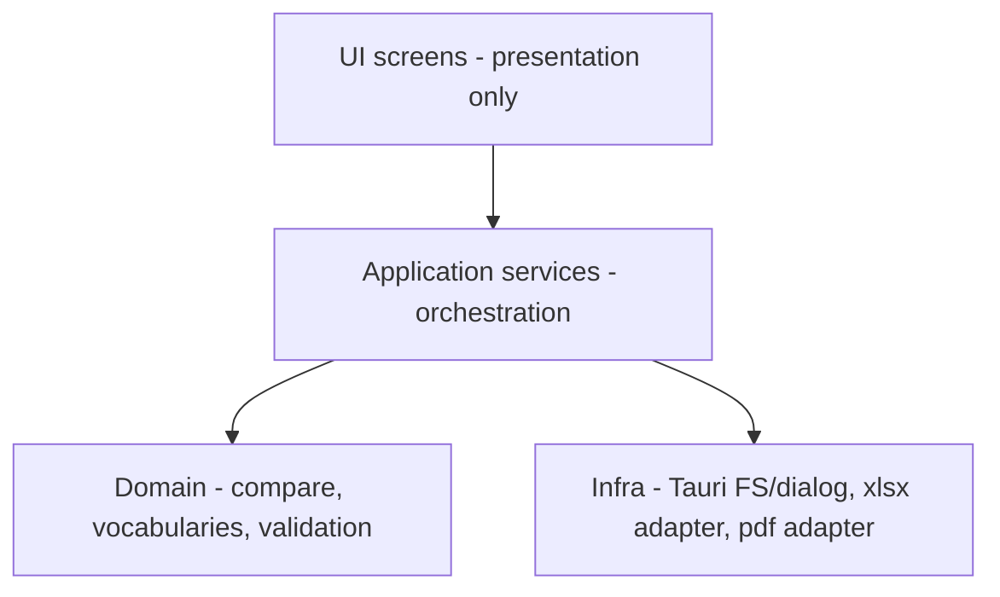

# Rework Notes — Intent for v5+

Planning notes for a full rewrite: new UI, new implementation, tests, better performance. Product intent docs are normative; this file captures **recommended engineering direction**.

Status: drafted 2026-03-11 from codebase exploration. Not yet a committed roadmap.

---

## Why rewrite

| Pain | Evidence |
|------|----------|
| No tests | Zero unit/e2e; release on every `main` push |
| Fragile schemas | Column contracts only implicit in parsers |
| Session brittleness | `history.state` only; hardcoded Processing fallbacks |
| Performance | UI-thread SheetJS; O(n×m) GTIN join; full clones |
| Logic in UI | Auto-fill / SIEB rules live in `EditorScreen` |
| UI debt | Mixed libraries; a11y gaps; color-only status |
| Stale docs | structure.md vs actual `.ts` modules |

---

## Suggested architecture (target)

### Principles

1. **Domain pure** — parse/normalize/compare/auto-actions as pure TS (or WASM/Rust later) with fixtures.
2. **Validate at boundaries** — fail with German operator-facing messages when columns missing.
3. **Single session store** — durable draft (local file or app-data JSON) + explicit Save.
4. **Worker for heavy IO** — parse/compare off UI thread when datasets are large.
5. **UI is replaceable** — grid/table is an adapter; domain does not import AG Grid.
6. **Release gated** — tests on PR; draft or manual promote for GitHub Release.

---

## Suggested workstreams

### 1. Intent freeze

- Confirm open questions in [product-intent.md](./product-intent.md).
- Lock vocabularies and sheet names with Logistik.
- Collect anonymized sample Master / ERP / RFID / Barcode / exported Abgleich.

### 2. Domain extraction (before UI polish)

- Port `compare.ts` / parsers behind typed models + tests.
- Move auto-Kommentare / SIEB rules into domain.
- Golden-file tests for sheet outputs.

### 3. New application shell

- Session model: files → processing result → editor draft → exports.
- Remove history.state as sole persistence.
- Replace Processing fallback paths with hard error.

### 4. New UI

- Redesign Start / Upload / Processing / Editor for clarity and a11y.
- Preserve information architecture from [feature-parity.md](./feature-parity.md) unless product changes.
- Status never color-only; keyboard-first LotId editing.

### 5. Performance

- Index Master by GTIN (`Map`).
- Stream or chunk TXT parse if needed.
- Debounce ArtNr recompute or maintain incremental aggregates.
- Avoid full workbook `structuredClone` when possible.

### 6. Platform / CI

- Fix process plugin registration if keeping relaunch.
- Tighten FS scopes to chosen directories where possible.
- Add Vitest (domain) + Playwright/Spectron-equivalent or Tauri driver smoke.
- Version bump automation; stop hardcoding version in window title.
- Consider release draft + human approve.

---

## Migration strategy options

| Strategy | Pros | Cons |
|----------|------|------|
| **Greenfield package** in-repo (`app-v5/`) | Clean break | Dual maintain briefly |
| **Strangle** — replace lib first, then screens | Continuous ship | Temporary hybrid mess |
| **New repo** | Clean history | Updater URL / identity migration |

Recommendation: **strangle domain first** (tests + typed compare), then new UI shell, keep bundle id + updater endpoint stable for staff.

---

## Risks

1. Silent change to ArtNr counting semantics breaks logistics expectations.
2. Changing To Do strings breaks downstream human process.
3. Public updater URL / signing key rotation mid-rollout.
4. SheetJS license/CDN packaging constraints.
5. Field laptops with large ERP files — must measure before promising speedups.

---

## Definition of done (rewrite)

- [ ] Product intent signed off by Logistik / Außendienst stakeholder
- [ ] Feature parity Must-list checked
- [ ] Domain unit tests + fixture pack
- [ ] E2E happy path on Windows
- [ ] No hardcoded machine paths
- [ ] Session recoverability (save/load draft or Excel)
- [ ] Performance baseline documented (N lots, time to editor)
- [x] Release pipeline with tests + signing (cargo test gate on PR + before release; signing unchanged)
- [ ] Operator doc updated (German) for new UI
