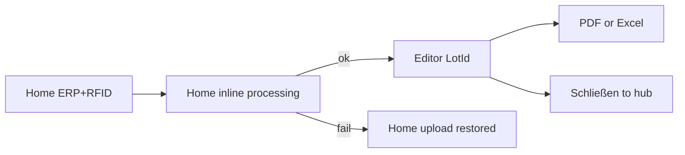
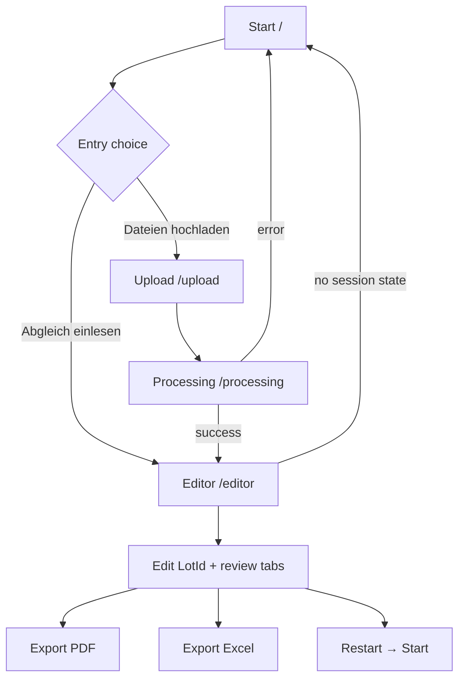
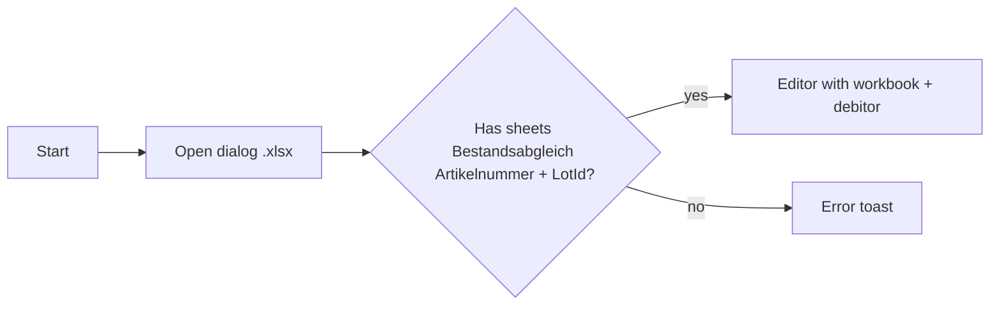

# User Flows — RFID Bestandsabgleich

Companion to [product-intent.md](./product-intent.md). Sections below describe operator journeys as implemented in **v4.1.3**. Rewrite target journey is summarized first.

---

## Rewrite journey (target)

Document hub + persistent projects. Visual mocks: [ux-mockups/start-screen](./ux-mockups/start-screen/README.md).

| Step | What the operator sees | Notes |
|------|------------------------|-------|
| Home | ERP + RFID dropzones, **Abgleich starten** | **No Master** on this path (GTIN already in-app) |
| Inline processing | Banner becomes Abgleich läuft / fertig / fehlgeschlagen; insights + inventuren stay | **No PDF/Excel**; error → Erneut versuchen keeps files attached |
| Editor | LotId grid + Speichern / Excel / PDF / **Schließen** | Project created + autosaved on successful compare |
| Hub return | Inventuren file card **Offen** / **Exportiert** / **Fertig**; insight counts refresh | Project persisted; optional toast |

Resume: open a file card from the hub (no disk-path hunt). Legacy “Abgleich einlesen” Excel import remains available as import path.

---

## High-level journey (v4.1.3 today)

---

## Happy path — new inventory (v4.1.3)

### 1. Start (`StartScreen` → `/`)

**Goal:** Orient and choose entry.

**Actions:**

- Read welcome copy (RFID scan + ERP reconciliation).
- Optional: accept auto-update dialog (~1.5s after mount).
- Toggle light/dark theme.
- Click **Dateien hochladen** → `/upload`.

**Alternate:** **Abgleich einlesen** → open Excel → jump to Editor (see [Resume flow](#resume-flow--abgleich-einlesen)).

---

### 2. Upload (`FileUploadScreen` → `/upload`)

**Goal:** Collect absolute file paths for processing.

| Slot | Label | Required | Extensions |
|------|-------|----------|------------|
| master | Inventur-Master | Yes | `.xlsx`, `.xls` |
| erp | ERP-Daten | Yes | `.xlsx`, `.xls` |
| rfid | RFID-Scan Daten | Yes | `.txt` |
| barcode | Barcode-Scan | No | `.txt` |

**Interactions:**

- Click dropzone → Tauri open dialog.
- Drag-drop via Tauri `tauri://drag-drop` events.
- Remove assigned file.
- **Zurück** → `/`.
- **Daten verarbeiten** enabled only when `master && erp && rfid` → `/processing` with `{ master, erp, rfid, barcode? }` in wouter `history.state`.

**Errors:** Wrong extension → Error toast *“Ungültiger Dateityp”*.

---

### 3. Processing (`ProcessingScreen` → `/processing`)

**Goal:** Parse files, run comparison, offer early export or open editor.

**Pipeline:**

1. Read files (`processFiles` / `readFiles.ts`).
2. Compare (`compareFiles` / `compare.ts`).
3. Progress messages + bar (UI-thread work; artificial waits for UX).

**On success:**

- Show **Editor öffnen** → `/editor` with `{ masterData, debitor }`.
- Enable PDF / Excel download (same as editor). ← **Rewrite: drop downloads on processing; auto-advance to editor.**

**On failure:**

- Error state + **Abgleich neustarten** → `/`.
- Downloads disabled.

**Zurück:** `/upload` with previous file paths restored.

> **Rewrite risk:** If `history.state` is missing, ProcessingScreen falls back to hardcoded developer paths. Must not ship in a rewrite.
>
> **Rewrite path:** Home (ERP+RFID only) → **inline processing on home** (no downloads, no `/processing` route) → Editor → **Schließen** → hub with project kept.

---

### 4. Editor (`EditorScreen` → `/editor`)

**Goal:** Inspect raw scans/ERP, reconcile at LotId, export, restart.

**Gate:** Missing `history.state` → redirect `/`.

**Default tab:** LotId (`Abgleich nach LotId`).

#### Sidebar — Bestände (read-only)

| Tab | Sheet | Purpose |
|-----|-------|---------|
| ERP | `Ax-Bestand` | Expected stock lines |
| Barcode | `Barcode-Scan` | Optional barcode inventory |
| RFID | `RFID-Scan` | Deduped enriched RFID lines |

#### Sidebar — Vergleiche

| Tab | Source | Purpose |
|-----|--------|---------|
| LotId | Editable state ← `Bestandsabgleich LotId` | Primary work surface |
| Artikelnummer | Derived aggregates | Count-level ERP vs RFID |
| Scan | `Vergleich der Scans` | LotId presence Barcode vs RFID |

#### LotId work loop

1. Scan color-coded ERP/RFID cells (green match / red missing / amber extra).
2. Edit `RFID-Scan` (0/1), `To Do`, `Anmerkung`, `Stichprobe`.
3. Optionally multi-select → bulk apply To Do / Anmerkung / RFID.
4. Optionally **Auto SIEB/INST & Offene Posten**.
5. Optionally **Auto-Kommentare**.
6. Watch Stichproben badge toward **done / required** (`required = ceil(1% of Ax ERP quantity)`).
7. Spot-check ArtNr tab for aggregate Differenzen.
8. Export PDF and/or Excel from sidebar (blocked until Stichproben quota met).
9. **Fertig melden** when quota met → status Fertig → hub.
10. Or **Schließen** → hub; project persisted (Offen / Exportiert / Fertig on file card).

**Important:** ArtNr recomputes from LotId on every LotId change. Raw ERP/RFID/Barcode/Scan tabs do **not** update after LotId edits.

---

## Resume flow — Abgleich einlesen

- Debitor taken from `Ax-Bestand[0].Debitorenkonto` or `"Unbekannt"`.
- Skips upload + processing entirely.
- Use case: continue annotations later, or re-export PDF.

---

## Update flow

Only on Start:

1. `UpdaterDialog` calls Tauri updater `check()`.
2. If update available → show Install / Later.
3. Install → downloadAndInstall → relaunch.

Depends on public GitHub Releases `latest.json` + signing keys.

---

## Error / edge matrix

| Situation | Behavior |
|-----------|----------|
| Missing required upload files | Process button disabled |
| Invalid file extension | Toast; file not accepted |
| Processing exception | Error UI; restart to Start |
| Unknown GTIN on RFID | Artikelnummer / Produktname / Kennzeichen 3 = `"Unbekannt"` |
| No barcode file | Barcode + Scan sheets empty / absent; other flow OK |
| Duplicate RFID LotId | First occurrence kept |
| Empty LotId on RFID | Skipped in dedupe map |
| Direct navigate to `/editor` | Bounce to `/` |
| Restart confirmed | Session discarded; no autosave |
| Auto actions find nothing | Error toast |
| Expired Ablaufdatum | Red cell styling in ERP/LotId tables |
| Ablaufdatum &lt; 3 months | Amber styling |

---

## Screen map (routes)

| Path | Component | State in | State out |
|------|-----------|----------|-----------|
| `/` | `StartScreen` | — | open file → editor state |
| `/upload` | `FileUploadScreen` | optional restored paths | file path map |
| `/processing` | `ProcessingScreen` | file paths | `{ masterData, debitor }` |
| `/editor` | `EditorScreen` | `{ masterData, debitor }` | — (mutates workbook in place) |
| `*` | 404 text | — | — |

Navigation library: **wouter**. Session transport: **`history.state` only** (no persistence layer).

---

## Operator checklist (field day)

1. Request / prepare Master template for Debitor.
2. Export same-day ERP stock for that Debitor.
3. Run RFID inventory; export TXT from device.
4. Optional: barcode inventory TXT.
5. Install/update Bestandsabgleich.
6. Upload → process → LotId work → Stichproben → PDF sign → Excel to Logistik.
