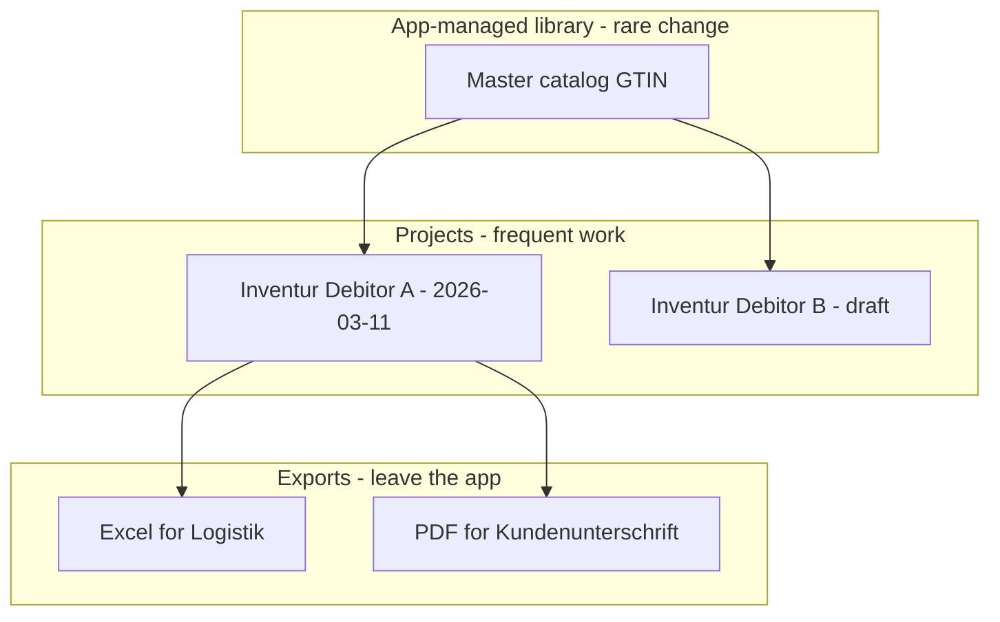
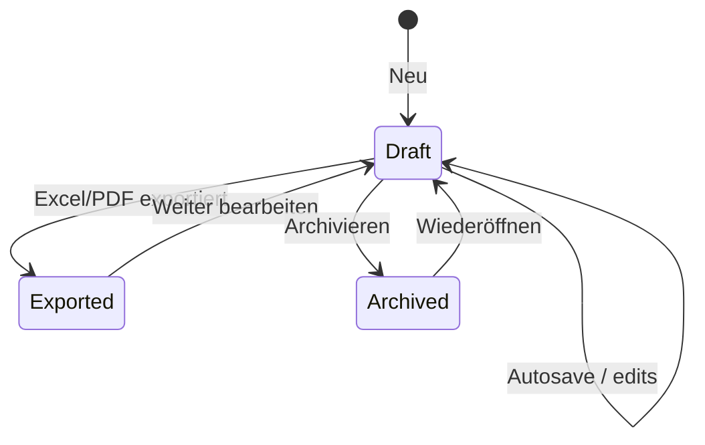

# UX Proposal — Document Model, Master Library & Recent Work

Status: **proposal for rewrite** (2026-03-11). Aligns with pain points: re-uploading Master every session, no Recent work, closing the app discards edits.

Mental model target: **closer to Microsoft Office** than to a one-shot upload wizard.

---

## Problems with the current UX

| Today | Why it hurts |
|-------|----------------|
| Master Excel required on every Inventur | Catalog barely changes (~years); ritual friction with no value |
| Session lives only in `history.state` | Close / crash / restart = total loss |
| “Abgleich einlesen” only via file dialog | User must remember where the last Excel was saved |
| Export Excel = only durable save | Editing and “handing off to Logistik” are conflated |
| Start screen is a dead-end welcome | No workspace of ongoing jobs |

---

## Core mental model (proposed)

Split three concepts that are currently mashed together:



1. **GTIN catalog (in-app)** — shared for all clients; seeded/updated by importing the Master Excel (copy into app). Fast structured store, not xlsx at runtime.
2. **Inventur project** — the unit of work (like a Word document): ERP + scans + LotId edits + metadata.
3. **Export** — Excel/PDF **generated by the app** from project data + fixed schema. Not “Master workbook + appended sheets.”

Users should think: *“I open my Inventur for Klinik X”* — not *“I upload three files into a wizard again.”*

---

## 1. GTIN catalog — import Master once (copy)

### What the Master file is (rewrite)

| Fact | Detail |
|------|--------|
| Audience | **Same file for all clients** |
| Purpose of the Excel | **Source** to load/update the in-app GTIN → product map (RFID tags don’t carry full product info) |
| Not its job anymore | Defining export workbook layout by being cloned — **the program creates the result Excel** |
| On disk | Import **copies** data into the app; we do not edit the user’s Master file in place |
| Updates | **Additive** — new GTINs appear; **existing GTIN mappings never change** |
| Effect on projects | **New** projects simply see new GTINs when needed. **Existing** projects do **not** need a re-enrichment pass for known GTINs |

### Behavior

- First launch / empty catalog: prompt **“GTIN-Liste / Master importieren”**.
- Parse Master → upsert into in-app store (`GTIN` primary key; skip-or-ignore changes to existing keys if file ever disagrees — product rule: existing never change).
- Optionally keep a copy of the last imported Master file for audit; **runtime enrichment uses the DB/index only**.
- New Inventur: no Master upload step.
- Bibliothek / Einstellungen: GTIN count, last import date, source filename, *Aktualisieren (neue GTINs)* .

### UX copy (German direction)

- Empty: *“Die GTIN-Liste gilt für alle Kunden. Einmal aus dem Master-Excel übernehmen — danach speichert das Programm sie intern (schnell, ohne Excel bei jeder Inventur).”*
- Ready: *“GTIN-Katalog · N Einträge · zuletzt aktualisiert …”* · *Neue GTINs importieren*
- Update hint: *“Bestehende GTINs ändern sich nicht. Es werden nur neue Einträge ergänzt.”*

### Why not keep Master as xlsx in the hot path

- Performance: O(1) map / SQLite vs SheetJS sheet scans every run.
- Clarity: export schema owned by the app (testable, versioned), independent of incidental Master sheets.
- Stability: additive catalog updates don’t reshape old exports mid-flight.

---

## 2. Inventur project — the document

### What a project contains (logical)

| Part | Source | Mutable in editor? |
|------|--------|-------------------|
| Metadata | Debitor, created/updated, optional Ort/Notiz | Yes (notes) |
| Master snapshot ref | Which Master version was used | No (immutable link) |
| ERP rows | Imported once at create/reimport | Replace via “ERP aktualisieren” |
| RFID rows | Imported | Reimport allowed |
| Barcode rows | Optional | Reimport allowed |
| LotId / ArtNr working tables | Derived + user edits | Yes |
| Autosave revisions | Internal | System |

Projects are stored in **app-managed storage** (e.g. `%APPDATA%/…/projects/<id>/`). User never *has* to know the folder — but advanced “Ordner im Explorer zeigen” is fine.

### Lifecycle



Suggested statuses for Recent list:

- **In Bearbeitung**
- **Exportiert** (last Excel/PDF timestamp)
- **Archiviert** (hidden from default Recent, searchable)

---

## 3. Home screen — what users actually need

Daily home is **not** a catalog admin screen and **not** a Win32 control panel.

### Jobs on open (&lt;3 seconds)

1. Continue unfinished Inventur (if any)  
2. Open a recent Inventur  
3. Start **Neue Inventur**

### Do **not** put on home

- GTIN count / “Bibliothek” dashboards — rare; **Einstellungen** or first-run setup only  
- Master upload  
- Version / autosave / technical status as primary content  

### Useful project fields on the list

- Customer / name, Debitor, relative time  
- Status only when helpful (`Offen` vs done)  
- Stichprobe hint only for an open/incomplete resume — not a permanent noisy column  

### Neue Inventur flow (slim)

Because Master is already in the library:

1. Name (optional; default `Inventur {Debitor} {Datum}` after ERP import)
2. **ERP-Datei** (required)
3. **RFID-Scan** (required)
4. **Barcode** (optional)
5. Verarbeiten → open Editor (project already created + first autosave)

No Master dropzone on this path.

---

## 4. Saving — Office rules

### Autosave (default on)

- Persist after meaningful edits (debounced, e.g. 1–2 s) and on blur/navigate/export.
- On launch after crash: *“Nicht gespeicherte Sitzung wiederherstellen?”* if a dirty lock file exists (usually unnecessary if every edit autosaves).
- Window title: `Bestandsabgleich — {Projektname}` + soft indicator only if a write is pending.

### Explicit save is optional

For trust, still offer **Speichern** (Ctrl+S) that forces flush + toast *“Gespeichert”*. Autosave does the real work; button is psychological safety (Office does both).

### Closing the app

- Never discard silently.
- If autosave healthy: close immediately.
- If flush failed: block close with error + retry.

### “Save As” / copies

- **Duplizieren** creates a new project id (branching “what-if”).
- **Export Excel** remains the logistics handoff — does **not** replace the internal project.

---

## 5. Recent work — regardless of original disk path

Office pattern:

1. User once picked `D:\Scans\rfid.txt` and `\\share\erp.xlsx`.
2. App **ingested copies** (or normalized snapshots) into the project.
3. Recent opens the **project**, not the original path.
4. Original paths stored as metadata (“Quelle ERP: …”) for audit, but reopen does not depend on them still existing.

Optional: **Erneut importieren** if they got a corrected ERP file the same day.

This directly answers: *open recent work in the program directly regardless where the file is saved on disk.*

---

## 6. Editor UX implications

- Sidebar footer: **Speichern** (flush) · **Excel exportieren** · **PDF** · **Schließen** (back to hub, not “discard forever”).
- Restart dialog today (“alles verloren”) becomes **Schließen** → hub; project remains.
- Destructive: only **Projekt löschen** / **Archivieren** with confirm.
- Banner if Master library was updated since project creation: *“Neuer Master verfügbar — nur neue Inventuren nutzen ihn”* or offer *Mit neuem Master neu vergleichen* (dangerous; product decision).

---

## 7. Exports vs projects (keep both)

| Action | Audience | Durability |
|--------|----------|------------|
| Internal project save | Field user | Primary working copy |
| Excel export | Logistik / archive outside app | Snapshot; may still be re-imported as *new* project or “update from Excel” later |
| PDF export | Kunde signature | One-shot document |

Do **not** remove Excel round-trip — logistics process likely still needs the file. Decouple it from “how I keep my work.”

---

## 8. Storage sketch (implementation-facing, not final)

```
%APPDATA%/de.implantcast.rfid-bestandsabgleich/
  library/
    gtin.sqlite          # or gtin.json — canonical catalog (GTIN PK)
    meta.json            # lastImportAt, sourceFileName, gtinCount
    imports/             # optional archived copies of imported Master xlsx
  projects/
    {uuid}/
      project.json
      erp.*
      rfid.*
      barcode.*
      lotid.*
      artnr.*
  recents.json
```

On Excel export: **`rust_xlsxwriter` (or equivalent) builds a new workbook** from project tables + documented sheet schema — no Master clone.

Prefer SQLite for the GTIN catalog if the list is large; JSON is fine if modest and always loaded once into a `HashMap` at startup.

Backup story (nice-to-have): *Bibliothek sichern…* zips `library/` + `projects/`.

---

## 9. Accessibility & field constraints

- Offline-only; no account.
- Large hit targets on Recent rows (laptop + sometimes awkward docking).
- German labels; keyboard: Ctrl+S save, Ctrl+O open Recent/search, Ctrl+N new.
- Don’t require cloud OneDrive semantics — local Office “Recent + Autosave” is enough.

---

## 10. What we deliberately do *not* copy from Office

- No real-time co-authoring.
- No SharePoint/OneDrive dependency.
- No ribbon megastructure — keep a calm hub + focused editor.
- No mandatory “Save As” dialog on first edit (autosave to library immediately on project create).

---

## Open decisions (need Logistik / field input)

1. ~~One Master vs many?~~ → **One shared GTIN catalog.**
2. ~~Re-enrich on update?~~ → **No** (existing GTINs immutable; additive only).
3. ~~Export sheet schema?~~ → **Keep today’s sheet names** for Logistik parity (app-generated workbook).
4. Should Excel export be re-importable *into the same project* or only as a new project / legacy path?
5. Retention: auto-archive projects older than N months?
6. Is project title free text or always derived from Debitor + date?
7. Machine change: how do staff move work laptop → laptop (backup zip must include `gtin` store + projects)?

---

## Success criteria for this UX

- Day-2 Inventur: **zero Master upload** if library already filled.
- Close app mid-edit → reopen same project with edits intact.
- Home shows last projects without browsing disk.
- Excel/PDF still available; no longer the only save mechanism.
- New users understand “Master = Bibliothek” vs “Inventur = Dokument” within one session.

---

## Related docs

- [product-intent.md](./product-intent.md)
- [user-flows.md](./user-flows.md) — to be revised once this proposal is accepted
- [feature-parity.md](./feature-parity.md) — add Musts for library + Recent + autosave
